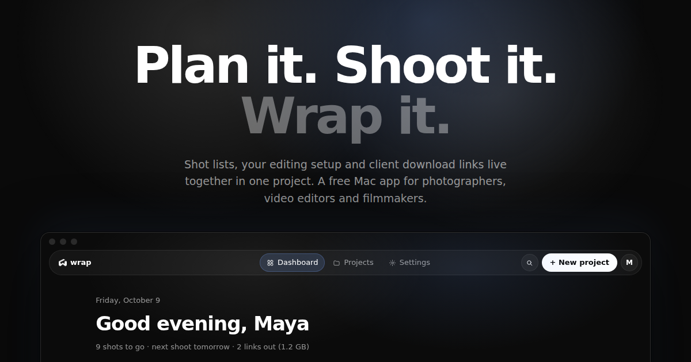

  

<h1 align="center">Wrap</h1>

  A free Mac app for photographers, video editors and filmmakers. 
  Plan the shoot, set up your edit, and send the final file to your client, all from one project.

  <a href="https://getwrap.pages.dev"><b>Download for Mac</b></a> ·
  <a href="https://getwrap.pages.dev">Website</a> ·
  macOS 26+ · v1.4

  

## Why I made it

I wanted one place for a whole project instead of jumping between a bunch of different apps: one for the shot list, one for setting up my edit, and another for sending the file. Something like Dropbox only cares about the final file. Wrap keeps the project around it too, so the shots, the workspace and the delivery stay connected.

## What it does

| Stage | What you can do |
| ----- | --------------- |
| **Plan** | Make a shot list with reference images, outfits, locations and notes. Save shot lists as templates and get a reminder before a shoot. Check shots off while you're shooting. |
| **Edit** | Add your editor, project file, footage folder, music and websites to a project's workspace. Arrange the windows once, then **Launch Workspace** opens everything where you left it, from the app or the menu bar. |
| **Deliver** | Drop the finished file into the project and get a download link that expires. Big files upload in pieces and pick back up if your connection drops. You get a notification when the client downloads it. |

Also: syncing between your Macs, search, a menu bar launcher and in-app updates.

## How it's built

- **App:** SwiftUI, with projects, shots and workspace layouts stored locally in SwiftData.
- **Workspace launcher:** `NSWorkspace` opens apps, files and folders. Moving and resizing other apps' windows needs Accessibility permission, which you grant once in System Settings.
- **Accounts and sync:** Supabase handles sign-in and keeps your library in sync between Macs.
- **Delivery:** a small Cloudflare Worker (`worker/`) creates the upload and download links. Files are stored in Supabase Storage and cleaned up automatically after they expire.
- **Updates:** Sparkle, with the update feed in `updates/`.

## Run it yourself

1. Clone the repo and open `Wrap/Wrap.xcodeproj` in Xcode (macOS 26 SDK).
2. Set your own Supabase project in `SupabaseConfig.swift`, and run `supabase/schema.sql` and `supabase/deliveries.sql` in it.
3. To test delivery, deploy the worker from `worker/` with `npx wrangler deploy` and put its URL in `DeliveryConfig.swift`.
4. Build and run.

## What's next

- A **Wrap disk**: export straight from your editor to a drive in Finder and have the upload start while it's still exporting. That's the part that would make Wrap more than another upload app, and it's the hardest one to build.
- No iPhone app, team accounts or Windows version for now. Wrap is free.
